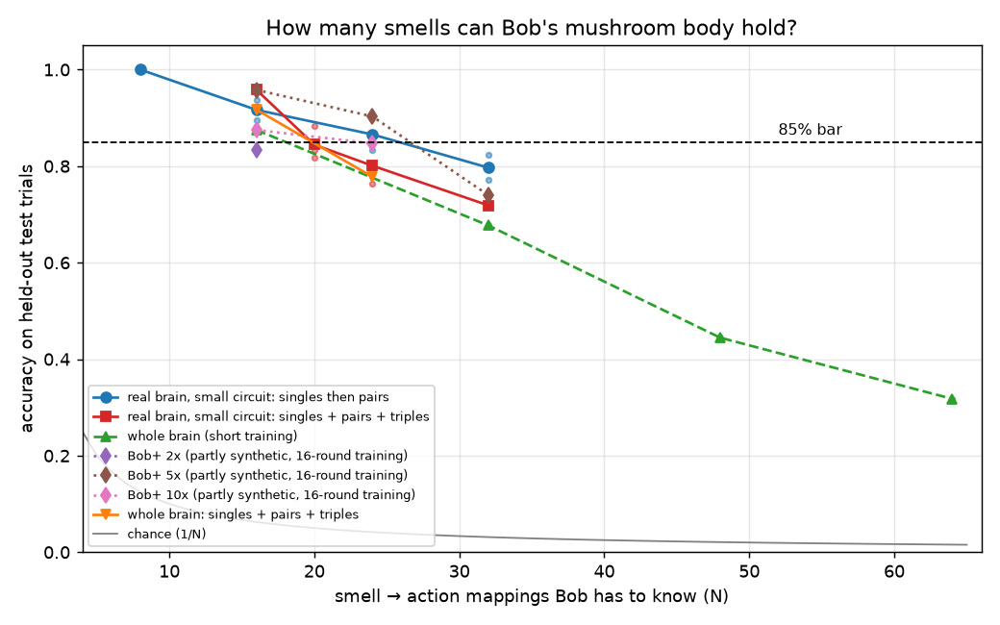

# Bob 🪰 - a fruit-fly brain that runs Linux commands and talks to AI models

Bob is a simulated fruit fly brain built from the real wiring diagram of a fly (the FlyWire connectome:
138,639 neurons, 15 million connections). Give Bob a **smell** and his brain decides what to do. Every decision is
one of 96 harmless Linux commands that run inside a locked-down Docker sandbox: make a file, list his files,
tell the time, count, roll a dice, and so on. Bob learns which smell means which command the way real flies learn,
with a dopamine-style signal at his mushroom body, the fly's learning center.

An AI model (or a simple keyword matcher) can sit in front of Bob. You type "make a file called hi", the AI picks
the smell for that, Bob smells it, his neurons vote, and his choice runs in the sandbox. You always see what Bob
picked compared with what you asked for, because Bob is a real (simulated) fly and can get it wrong.

## What Bob can do

| | |
|---|---|
| Brain | full FlyWire brain (138,639 neurons) or the smell-to-decision part of it (6,293 real neurons) |
| Smells | 8 base smells (A-H), used alone, in pairs and in triples |
| Actions | 20 (whole brain: 16) learned smell → action pairs (out of a 96-action menu) |
| Accuracy | 88% (whole brain: 92%) on held-out test trials |
| Speed | about 0.5-0.9 s per decision with the small brain, about 4 s with the full brain (2-core laptop) |

## How it works

```
smell (A, A+C, B+D+F ...)
  -> projection neurons of that smell's glomeruli fire        (real neurons, real wiring)
  -> Kenyon cells of the mushroom body                         (real PN->KC wiring)
  -> KC -> MBON synapses  <== the only part that learns        (start from the real synapse counts)
  -> 96 mushroom-body output neurons (MBONs) vote               (real neurons)
  -> the MBON group with the most spikes = Bob's action
  -> the action's fixed command runs in the sandbox container
```

**Learning.** During training Bob smells each smell, his MBONs fire, and a dopamine-like teaching signal tells every
MBON group how far it was from what it should have done. The right action's group should fire; every other group
should stay quiet. The active Kenyon-cell synapses onto each group get stronger or weaker in proportion to that error
(a prediction-error rule, like the dopamine neurons in the fly mushroom body). Only synapses that exist in the
connectome can change, and each one can only move between 0 and 10x its starting strength.

## How many smells can a fly brain hold?



We kept adding smell → action pairs (singles first, then pairs, then triples) until accuracy on fresh test trials
dropped below 85%. Each run trains from scratch; the test uses new trials Bob never trained on (new random spikes,
new smell strength). Chance is 1/N.

| mappings (N) | what's in the set | real brain, small circuit (3 random seeds) | whole brain |
|---|---|---|---|
| 8 | 8 single smells | 100%, 100%, 100%, 100% (16-round training) | |
| 16 | 8 singles + 8 pairs | 92%, 90%, 94% | 88% * |
| 24 | 8 singles + 16 pairs | 90%, 86%, 83% | |
| 32 | 8 singles + 24 pairs | 77%, 82% | 68% * |
| 48 | singles + all 28 pairs + 12 triples | | 44% * |
| 64 | singles + pairs + 28 triples | | 32% * |
| **16** | **5 singles + 6 pairs + 5 triples** | **96%, 96%, 96%** | **92%** |
| **20** | **7 singles + 6 pairs + 7 triples** | **88%, 82%, 83%** | |
| 24 | 8 singles + 8 pairs + 8 triples | 79%, 85%, 76% | 78% |
| 32 | 8 singles + 12 pairs + 12 triples | 72% | |

\* whole-brain runs marked * used the earlier, shorter training (16 rounds, no mixture gain control); the rest used
the final recipe (40 rounds, falling learning rate, mixture gain control). Held-out test = 3 fresh trials per
mapping. With 16 rounds and no gain control the small circuit got 73-92% at 16 and 78-81% at 24.

**Bob's final brain: 20 mappings** (7 singles + 6 pairs + 7 triples), 88% on Kaggle's held-out test and 85% / 88%
in two re-checks on a 2-core laptop. In those re-checks 18 of the 20 smells come out right almost every time and two
(A+G and D+F) almost never do, so those two carry the least-used actions. The whole-brain version knows 16
(92% held-out).

**Where it breaks:** single smells and the combos that contain them. Smell A's Kenyon cells are mostly still active
when Bob smells A+B (we measured 60-75% overlap), so A looks like a weaker A+B. Real flies have the same trouble
telling "A" from "A+B" apart.

### Bob+ (bigger, partly synthetic mushroom body)

The real fly has about 5,200 Kenyon cells. **Bob+** adds made-up (synthetic) Kenyon cells: 2x, 5x and 10x as many.
Each synthetic cell copies a random real Kenyon cell's outputs and other inputs, but gets its smell inputs from
randomly chosen projection neurons (fly-like random wiring, ~6-7 inputs each). All Kenyon-cell outputs are scaled
down by the same factor so the total drive onto the output neurons stays the same. **Bob+ is partly synthetic, not
a real fly.**

Measured on Kaggle CPU with the earlier 16-round training (no mixture gain control), smells added singles first,
then pairs, one random seed:

| brain | Kenyon cells | neurons | 16 mappings | 24 | 32 | holds (≥85%) | time per smell, laptop | peak RAM, laptop |
|---|---|---|---|---|---|---|---|---|
| real (small circuit) | 5,177 | 6,293 | 73% | | | 8 | 0.43 s | 504 MB |
| Bob+ 2x | 10,354 | 11,470 | 83% | | | 8* | 0.62 s | 504 MB |
| Bob+ 5x | 25,885 | 27,001 | 96% | 90% | 74% | 24 | 1.1 s | 551 MB |
| Bob+ 10x | 51,770 | 52,886 | 88% | 85% (84.7) | | 16 | 1.9 s | 819 MB |

\* not run at 8; 8 single smells were 100% on the real brain. More Kenyon cells help a little (5x did best), but
10x the cells does not mean 10x the memories: the 96 output neurons and the "A is inside A+B" overlap stay the
limits. A re-run of Bob+ with the final recipe was still running when this was written.

## Run it

Needs Linux, Python 3.10+, Docker, and ~1 GB of disk for the data.

```sh
python3 -m venv venv && ./venv/bin/pip install -r requirements.txt
PYTHON=./venv/bin/python sh get_data.sh        # downloads the FlyWire data (~135 MB) and builds Bob's cache
sh make_sandbox.sh                             # Bob's no-network Alpine sandbox (DOCKER="sudo docker" if needed)
./venv/bin/python demo.py --list               # the smell -> action menu Bob learned
./venv/bin/python demo.py A A+C B+D+F          # Bob smells, decides, and the command runs in the sandbox
./venv/bin/python demo.py A --brain full       # same, with the whole 138,639-neuron brain
echo "make a file called hi" | ./venv/bin/python talk_to_bob.py      # plain English -> smell -> Bob -> sandbox
```

Train your own Bob (a few minutes for 16 smells on a laptop):

```sh
./venv/bin/python train_combo.py --brain sub --N 16 --mix_norm 0.5 --blocks 40 --anneal 0.8 --out runs/my_bob
./venv/bin/python train_combo.py --brain plus --factor 5 --N 32 --out runs/bob_plus   # Bob+ (partly synthetic)
./venv/bin/python sweep.py lanes/real.json                                             # the capacity curve
```

A Kaggle CPU notebook works too: clone this repo, run `get_data.sh`, then `sweep.py`.

## Talking to Bob from an AI model or an app

`talk_to_bob.py` reads requests on stdin (plain text or `{"text": "..."}`) and prints one JSON result per line.
By default a keyword matcher turns your words into an action. To use a language model instead, point it at your own
server: a llama.cpp `llama-server` running any GGUF model, or any OpenAI-compatible endpoint:

```sh
./venv/bin/python talk_to_bob.py --llm-url http://127.0.0.1:8080                 # llama-server
./venv/bin/python talk_to_bob.py --llm-url http://HOST:PORT --llm-api openai --llm-model NAME
```

The model only picks **which action** you meant (from Bob's list). Bob's own brain still decides what actually
runs, and the model's words are never run as a command.

`bob_server.py` puts the same thing on your local network for phone, console or web apps:

```sh
./venv/bin/python bob_server.py --port 8095 --gen-key       # prints the key; send it as header X-Bob-Key
```

| endpoint | what it does |
|---|---|
| `GET /health` | `{"name":"Bob","neurons":6293,"actions":N,...}` |
| `GET /actions` | every action with its smell |
| `POST /smell` | `{"text":"make a file called hi"}` or `{"action":"make_hi"}` or `{"odors":["A","C"]}` → what was asked, the smell, Bob's choice, confidence, top votes, the command and its output |
| `POST /mind` | `{"lines":50}` → the last lines of Bob's mind log |

CORS is on, requests are limited to 2 per second, and only one smell runs at a time.

**Bob's mind log.** Every decision is written in plain English to `bob_mind.log` on the host, for example:

```
2026-10-10 06:57:41 Orbit heard "make a folder called box" -> sent smell C+D+F. Bob smelled C+D+F. 1344 memory cells (Kenyon cells) lit up. 'make a folder called box' won (8.2) over 'say which user he is' (5.4), pretty sure. Asked for 'make a folder called box' -> he got it right. Ran: mkdir -p /fly/box && echo "made folder /fly/box" -> made folder /fly/box
2026-10-10 06:57:41 Orbit asked "order me a pizza" but nothing on Bob's menu matched; no smell sent.
```

## Safety

- Bob can only run the commands written in the `MENU` list in `demo.py`. No text from you, from an AI, from the
  fly, or from the container is ever run as a command.
- Commands run only through `docker exec` in the container `flybrain-sandbox`, and only if it has the label
  `made-by=bob-flybrain` and **no network**. `make_sandbox.sh` also caps it at 64 MB of RAM and 64 processes,
  drops all Linux capabilities and blocks privilege escalation.
- Everything Bob writes or deletes is inside `/fly` in that container, and he can only delete the files he makes.
- Container output is only shown and logged, never run. The host side writes only `bob_mind.log`.

## What's simplified (please read)

1. **The nose is clamped.** In this model any smell sets off the whole antennal lobe, so every smell looked the
   same. So the sensory neurons, local neurons and other projection neurons are held silent, and each smell drives
   only its own projection neurons (5-7 glomeruli per base smell, each smell's set different from the others).
2. **Mixture gain control** (`--mix_norm`, used for Bob's final brain): in a mix of k smells each projection neuron
   fires at rate / k^0.5. This stands in for the antennal-lobe lateral inhibition the clamped nose removed.
3. **Projection neuron → Kenyon cell synapses are boosted 4x.** Without it Kenyon cells barely fire; with it about
   5-20% fire per smell (real flies: ~5-10%; our 3-smell mixes are denser).
4. **The learning rule is simplified.** A teacher signal tells every output group what it should have done
   (prediction-error dopamine). Real flies mostly learn by weakening synapses, and nobody tells them the right answer.
5. **The readout is ours.** Splitting the 96 MBONs into groups, one group per command, is our design; it is not a
   known fly behavior.
6. **No memory between smells** except the learned synapses. Each smell starts from a resting brain, lasts 100 ms of
   brain time, and the neuron model is a simple leaky integrate-and-fire model.
7. **Bob+ is partly synthetic** (see above).
8. Results are from a small number of random seeds; different random smell sets give different numbers.

## Files

| file | what |
|---|---|
| `flyengine.py` | the neuron simulator (numpy only) |
| `build_connectome.py`, `flycircuit.py` | load the FlyWire data, cut the reduced circuit |
| `bobbrain.py` | Bob: smells, combos, readout, learning rules, Bob+ |
| `train_combo.py`, `sweep.py`, `lanes/` | training and the capacity sweep |
| `demo.py` | the action MENU (allowlist), sandbox runner, mind log, smell demo |
| `talk_to_bob.py` | plain English / AI model → Bob (stdin → JSON) |
| `bob_server.py` | the LAN HTTP API |
| `export_bob.py`, `bob_fly/` | portable Bob: one numpy file + `run_bob.py` (numpy only, picks actions, runs nothing) |
| `results/` | capacity numbers and plot |

## Credits

The neuron model follows Shiu et al., *A Drosophila computational brain model reveals sensorimotor processing*,
Nature 2024, and its code https://github.com/philshiu/Drosophila_brain_model (MIT license). The wiring is the
FlyWire connectome (Dorkenwald et al. 2024; Schlegel et al. 2024; Matsliah et al. 2024), shared under CC BY-NC 4.0,
with cell types from https://github.com/flyconnectome/flywire_annotations. The data is downloaded from those
sources and is not in this repo. See THIRD_PARTY_NOTICES.md.

## License

Bob FlyBrain License (see LICENSE). © 2026 Nate's Tech Stuff.
